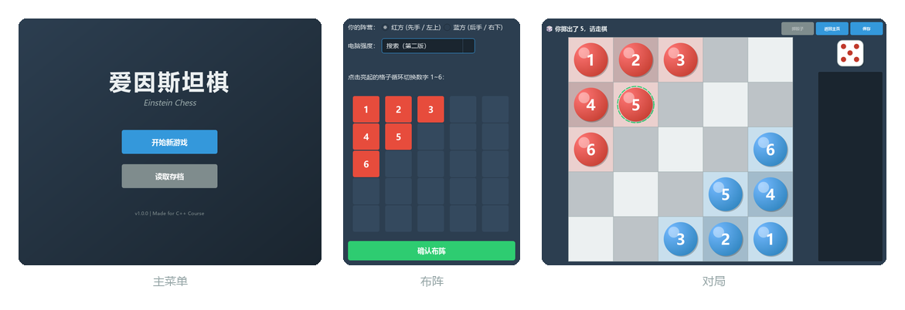

# ♟️ 爱因斯坦棋 (Einstein Chess)

<div align="center">

[](https://isocpp.org/)
[](https://www.qt.io/)
[](https://sqlite.org/)
[](https://github.com/nlohmann/json)
[](https://cmake.org/)
[](docs/BUILD.md)
[](LICENSE)
[](https://github.com/lyupengze/einstein-chess/actions/workflows/ci.yml)

**基于 C++17 与 Qt6 的 5×5 爱因斯坦棋人机对弈程序**

提供 GUI、CLI 与 Botzone 对战平台三个入口，支持图形化布阵、走法高亮提示，以及基于 SQLite 的本地多存档。

</div>

## 🖼️ 界面预览

<div align="center">
  
</div>

## 📖 规则速览

> **规则基准**：本项目以 Botzone 爱因斯坦棋裁判代码为准，不是自行设计的变体。下面只列容易与
> 常见棋类直觉冲突的要点，完整规则、骰点映射表与边界例见 [棋盘规则](docs/RULES.md)。

- **棋盘与目标**：5×5 棋盘，每方 6 枚棋子，编号 1–6 各一枚。红方从左上初始区出发，目标是右下角
  `(4,4)`；蓝方从右下镜像区出发，目标是左上角 `(0,0)`。
- **回合流程**：当前行棋方先掷骰，再移动一枚可选棋子，一次一格；双方布阵完成后红方先手。
- **掷骰选子**：优先选编号等于骰点的棋子；该编号不在场时，小于骰点的最大编号与大于骰点的
  最小编号都可选，可能有两枚。
- **走子方向**：红方向下、向右、向右下；蓝方向向上、向左、向左上，每步一格且不能越出棋盘。
- **可以吃己方棋子**：落点上的棋子无论敌我都会被移除。这是规则允许的合法着法，不是实现缺漏，
  也不是本项目添加的变体。
- **胜负**：一方棋子被全部吃光，或任一枚棋子到达对方目标角即获胜；两个条件不会指向不同
  胜者，判定顺序不影响结果。

## 🚀 快速开始

需要 CMake ≥ 3.20 与 C++17 编译器；GUI 还需要 Qt6。

```bash
cmake -S . -B build -DCMAKE_BUILD_TYPE=Release
cmake --build build --parallel 8
./build/bin/einstein_gui    # 或 ./build/bin/einstein_cli
```

`--parallel 8` 的数值按 CPU 核数与内存调整，不要写成裸 `-j`。构建完成后用 `ctest --test-dir build`
跑全部用例（24 个，清单与标签见 `tests/CMakeLists.txt`；`EINSTEIN_BUILD_GUI=OFF` 时跳过 `gui` 标签的用例）。无 GUI 构建、Qt6 查找、生成器与常见构建问题见
[构建与测试](docs/BUILD.md)；启动参数、布阵与存档落点见 [使用说明](docs/USAGE.md)。

## 📚 文档索引

| 主题 | 文档                                 | 内容                                 |
| ---- | ------------------------------------ | ------------------------------------ |
| 规则 | [棋盘规则](docs/RULES.md)            | 坐标、选子映射、方向、吃子与胜负顺序 |
| 操作 | [使用说明](docs/USAGE.md)            | GUI/CLI/Botzone 的操作流程与常见问题 |
| 构建 | [构建与测试](docs/BUILD.md)          | 依赖、测试清单、CI 与构建故障        |
| 架构 | [架构说明](docs/ARCHITECTURE.md)     | 分层、状态机与回合调用路径           |
| 存档 | [存档格式](docs/SAVE_FORMAT.md)      | 数据串字段、棋盘编码与读写校验       |
| 取舍 | [设计取舍](docs/DESIGN.md)           | 九项有意为之的设计与重新考虑的条件   |
| 性能 | [AI 性能基准](docs/BENCHMARK.md)     | 单步延迟、随机基线胜率与测量局限     |
| 协议 | [Botzone 协议](docs/BOTZONE.md)      | 单行 JSON、严格校验与错误处理        |
| 缺陷 | [缺陷台账](docs/HISTORY.md)          | 已修复缺陷的现象、根因、修复与回归   |
| 注释 | [注释与文档规范](docs/COMMENTING.md) | 注释层级、术语与措辞要求             |

## 📂 项目结构

```text
.
├── .clang-format         # 格式基线，CI 用它做 --dry-run 检查
├── .github/workflows/    # CI：构建、测试与格式检查
├── docs/                 # 规则、使用、构建、架构、存档、取舍、性能、协议、缺陷台账
├── src/
│   ├── core/             # 纯 C++：棋盘、规则、局面校验、对局对象
│   ├── ai/               # 随机档与搜索档，只依赖 core
│   ├── storage/          # SQLite 封装与存档读写
│   └── ui/
│       ├── gui/          # Qt6 界面
│       ├── cli/          # 终端入口
│       └── botzone/      # Botzone 协议适配
├── tests/                # CTest 用例、固定输入与共享测试头
├── benchmarks/           # 单步延迟与随机基线基准，不注册 CTest
├── third_party/          # SQLite amalgamation 与 nlohmann/json 单头文件
├── CMakeLists.txt        # C++17、统一 -Werror、产物输出到 build/bin
├── LICENSE
└── THIRD_PARTY_NOTICES.md
```

## 🧱 构建目标

产物统一输出到 `build/bin/`，共四个可执行程序：`einstein_gui`、`einstein_cli`、`einstein_botzone`、
`einstein_benchmark`（Windows 下带 `.exe` 后缀）。库与可执行目标之间的依赖关系见
[架构说明](docs/ARCHITECTURE.md)；测试目标由 `tests/CMakeLists.txt` 逐个创建。

## 📈 AI 性能基准

搜索档（深度 4、Release）在本机 i9-14900HX 上的单步中位数：残局约 0.8 ms，开局与中局约 8 ms，
分支最多的降级选子约 24 ms；对随机走子基线 40 局胜 38 局（算术胜率，样本小，不含置信区间）。
测量方法、环境与局限见 [AI 性能基准](docs/BENCHMARK.md)。

## ⚠️ 当前限制

- **AI 两档**：`ai::Level` 选择档位，默认档是搜索档；随机档在合法着法中均匀随机。搜索为固定
  深度的 Expectiminimax，不含 alpha-beta、置换表与时间预算。完整说明见 [设计取舍](docs/DESIGN.md)。
- **验证平台单一**：构建、测试与运行只在 Windows + MSYS2 UCRT64（GCC 16.2、Qt 6.11）上验证，
  CI 也只覆盖该平台；Linux 与 macOS 未验证，其他编译器在 `-Werror` 下的告警差异可能带来额外修改。
- **Toast 是绝对定位浮层**：坐标只在弹出时计算一次，父窗口缩放后提示条会停在上一次的位置。

## 📄 许可证

本项目以 **MIT License** 发布，完整文本见 [LICENSE](LICENSE)。Qt 在构建时动态链接（LGPLv3），
仓库只分发源码，不包含 Qt 的源码或二进制；SQLite amalgamation 为 public domain，
nlohmann/json 为 MIT。第三方组件的版本与分发边界见
[第三方组件与许可证说明](THIRD_PARTY_NOTICES.md)。

发布包含 Qt DLL 的便携包时，请按 notices 的清单附上 LGPLv3 文本与 Qt 版权声明，并保留用户替换
Qt 动态库的能力。

## 👥 作者

- **Spamton NEO**：独立完成
