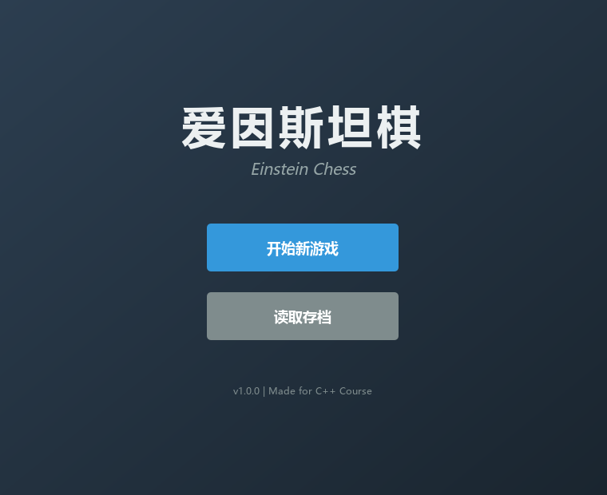
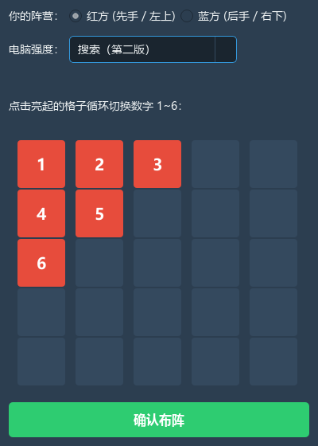
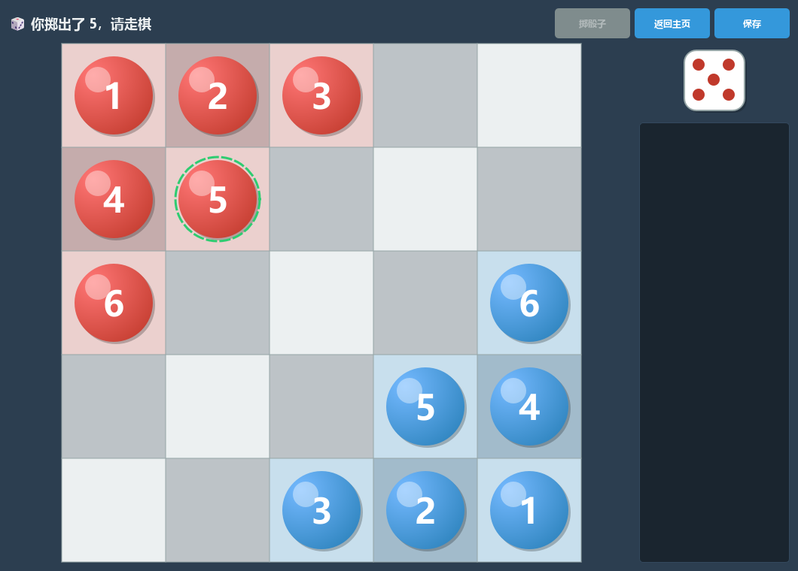

# 使用说明

项目提供三个可执行入口：图形界面 `einstein_gui`、命令行 `einstein_cli`、Botzone 适配器
`einstein_botzone`。三者共用 `core`、`ai`、`storage`，规则与存档完全一致，区别只在交互方式。

## 1. 图形界面

启动 `einstein_gui` 后先看到主菜单：



- **开始新游戏**：进入布阵对话框，选择阵营与电脑强度，然后布置自己的 6 枚棋子。
- **读取存档**：列出数据库里的存档槽位，选中后直接进入对局，电脑强度按存档记录恢复。

布阵对话框：



- 每点一次格子，编号在 1~6 之间循环；同一个编号不能放两次，确认时若重复会提示重排。
- 红蓝初始区是固定的 6 个格，点区域外的格子不会落子。
- “你的颜色”决定人类执红还是执蓝，红方先手；“电脑强度”来自 `ai::kAllLevels`，整局不变。

对局界面：



- 轮到自己时先点“掷骰子”，界面按骰点高亮可动棋子；点棋子看到可达格，再点落点完成走子。
- 规则允许吃己方棋子，因此高亮里包含己方棋子所在的格。
- “保存”会把当前局面写进存档库，并暂停尚未执行的界面延迟；“返回主页”放弃当前对局回主菜单。
- 电脑回合由界面自动推进，连续两次延迟分别对应掷骰与落子。

## 2. 命令行

```bash
./einstein_cli              # 存档库放在当前工作目录
./einstein_cli --db /tmp/save.db
./einstein_cli --seed 42    # 固定 AI 随机种子，便于复现同一局
```

`--seed` 接受 `0..4294967295`，`--db` 接受非空路径；参数不合法时打印原因并以退出码 2 结束，
存档库打不开时以退出码 1 结束。启动后会打印存档库的绝对路径。

主菜单：

```text
1. 开始游戏
2. 读档
3. 退出
```

开新局的顺序是：选强度 → 选颜色 → 输入自己的布阵排列（6 个 1~6 的整数）→ 开局。
人类回合先按回车掷骰，再输入 `起点行 起点列 终点行 终点列` 四个整数走子，例如 `0 2 1 2`；
输入 `save` 存档、`exit` 放弃本局，两者在掷骰与走子两个输入点都可用。电脑回合自动完成，
按回车继续。stdin 关闭时程序按“输入已结束”退出，不会循环打印提示。

## 3. Botzone

`einstein_botzone` 按 Botzone 的单行 JSON 协议工作，从 stdin 读一行、向 stdout 写一行。
协议字段、错误分类与本地验证方法见 [Botzone 协议](BOTZONE.md)：

```bash
echo '{"requests":[{"color":0}],"responses":[]}' | ./einstein_botzone
```

## 4. 存档位置

| 入口    | 默认位置                                | 说明                                    |
| ------- | --------------------------------------- | --------------------------------------- |
| GUI     | 可执行文件所在目录的 `einstein_save.db` | 启动时把工作目录切到可执行文件目录      |
| CLI     | 启动目录的 `einstein_save.db`           | 跟随 shell 的当前目录，可用 `--db` 覆盖 |
| Botzone | 不读写存档                              | 每局状态由请求自带                      |

把程序装到 `Program Files` 等只读目录时，GUI 无法写入默认位置，需要从可写目录启动，
或改用 CLI 的 `--db`。同一时间只应有一个进程写同一个存档库：数据库没有开启 `busy_timeout`
与 WAL，双进程并发写会得到 `SQLITE_BUSY`。

## 5. 常见问题

**棋盘能点，但棋子不动**：先确认已掷骰且点的是高亮棋子；规则只允许向前、向侧、向斜前方
走一格，落点必须在棋盘内。可用格会在选中后以虚线圈标出。

**读档后界面停在电脑回合**：这是正常流程，电脑会按延迟自动走子；若始终不动，说明存档局面
与该版本的状态机不兼容，读档时通常会直接报错而不是进入对局。

**中文在终端里乱码**：Windows 上 CLI 会尝试把控制台切到 UTF-8；若失败会打印警告，可手动
执行 `chcp 65001` 后重新启动。

## 6. 与构建文档的分工

构建步骤、测试用例清单与 CI 说明见 [构建与测试](BUILD.md)；界面与命令行之外的规则细节见
[棋盘规则](RULES.md)；程序内部的模块与状态机见 [架构说明](ARCHITECTURE.md)。
